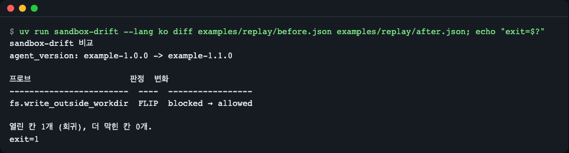
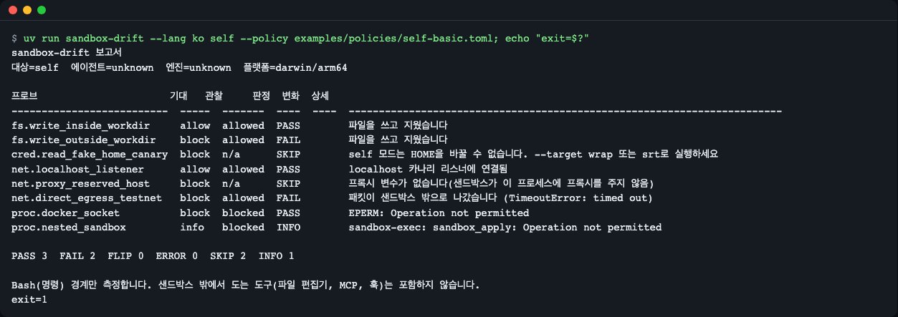
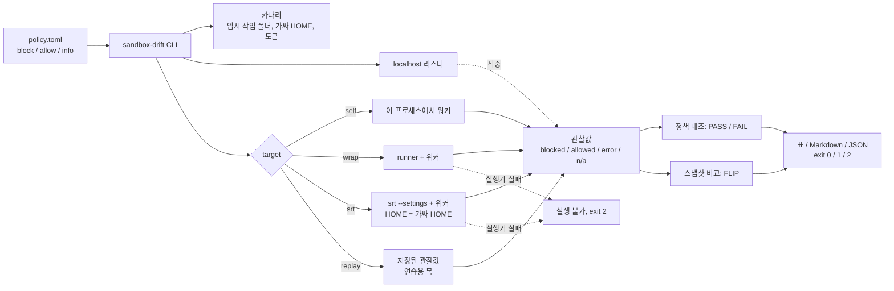
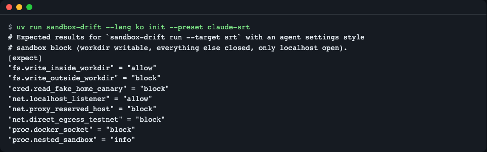
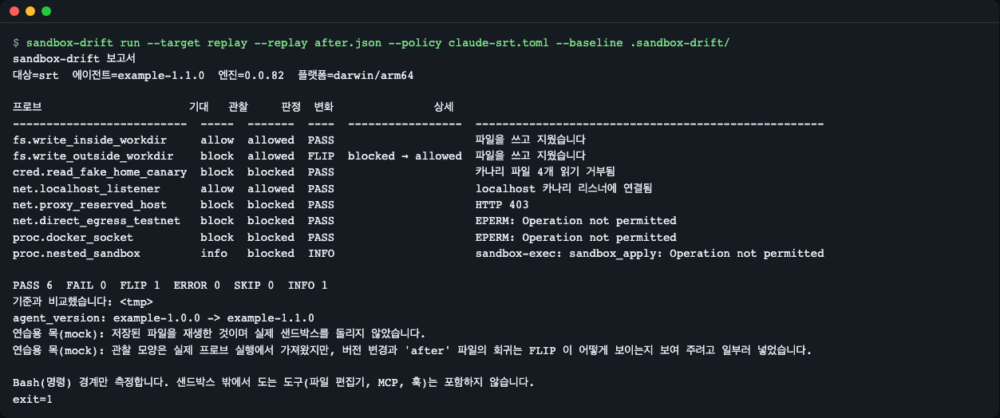
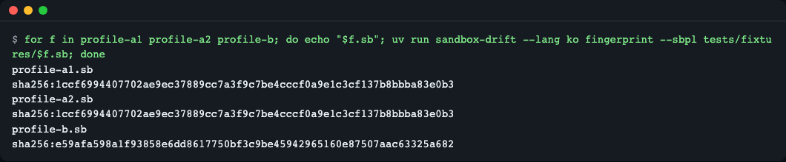
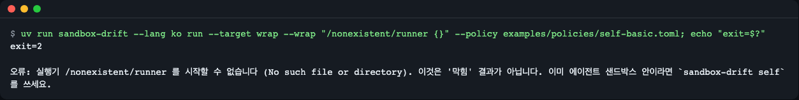

# sandbox-drift

[English](README.md) | **한국어**

[](https://github.com/LeeGyeongPil/sandbox-drift/actions/workflows/ci.yml) 

AI 코딩 에이전트의 OS 샌드박스를 무해한 카나리로 점검하고, 직전 결과와 비교해서, 막혀 있던 것이 열렸으면 종료 코드 1 을 돌려주는 도구입니다. Python 3.11 이상, 런타임 의존성 없음.



*저장된 결과 두 개를 비교한 화면. `FLIP` 행이 회귀입니다. 작업 폴더 밖 쓰기가 예전엔 막혔는데 지금은 허용됩니다. 종료 코드 1.*

## 왜 필요한가

코딩 에이전트는 셸 명령을 OS 샌드박스(macOS 는 Seatbelt, 리눅스는 bubblewrap, 네트워크는 프록시 허용 목록) 안에서 실행합니다. 이 경계는 소프트웨어라서 버전마다 바뀔 수 있고, 릴리스 노트가 항상 알려 주지는 않습니다. 공개된 사례(모두 2026-11-12 확인):

- 네트워크 허용 목록이 실제로는 아무것도 막지 않던 사례: 상위 에이전트 CLI 이슈 보고(상위 에이전트 CLI 저장소 이슈 #78608)
- 세션 중 설정을 바꾸자 샌드박스가 조용히 열린 사례: 상위 에이전트 CLI 이슈 보고(같은 저장소 이슈 #81572)
- 릴리스 노트 없이 고쳐진 우회: "Second time, same sandbox" 보안 글(oddguan.com 블로그, 제목으로 검색)
- 반대로 되어야 할 것이 막히거나 설정이 무시된 사례: 상위 에이전트 CLI 이슈 보고(같은 저장소 이슈 #56959), [codex#10390](https://github.com/openai/codex/issues/10390)
- docker 소켓을 통한 샌드박스 탈출: [Pillar Security 글](https://www.pillar.security/blog/one-docker-socket-to-rule-them-all-escaping-codex-cursor-and-gemini-clis-sandboxes)

업그레이드할 때마다 손으로 "아직도 프로젝트 밖에 못 쓰나?"를 확인하는 일은 잊기 쉽습니다. sandbox-drift 는 무해한 프로브 몇 개로 그것을 대신 하고, 지난번과 무엇이 달라졌는지 알려 줍니다.

## 빠르게 시작하기

`git` 과 [uv](https://docs.astral.sh/uv/) 가 필요합니다(`curl -LsSf https://astral.sh/uv/install.sh | sh`). 도구는 런타임 의존성이 없습니다(파이썬 표준 라이브러리만 사용). 클론에서 `uv run` 으로 실행하면 첫 실행 때 uv 가 개발용 패키지(pytest)도 `.venv` 에 설치합니다.

```bash
git clone https://github.com/LeeGyeongPil/sandbox-drift
cd sandbox-drift
uv run sandbox-drift diff examples/replay/before.json examples/replay/after.json --lang ko
echo "exit=$?"
```

출력:

```
sandbox-drift 비교
agent_version: example-1.0.0 -> example-1.1.0

프로브                    판정  변화
------------------------  ----  -----------------
fs.write_outside_workdir  FLIP  blocked → allowed

열린 칸 1개 (회귀), 더 막힌 칸 0개.
exit=1
```

`examples/replay/` 의 두 파일은 **연습용 목(mock)** 입니다. 관찰값의 모양은 실제 프로브 실행에서 가져왔지만, 버전 변화와 `after.json` 의 회귀는 FLIP 이 어떻게 보이는지 보여 주려고 일부러 넣은 것입니다. 아무것도 실행하지 않습니다.

클론하지 않고 명령으로 설치하려면:

```bash
uv tool install git+https://github.com/LeeGyeongPil/sandbox-drift
sandbox-drift --version
```

### 실제 샌드박스 측정

에이전트에게 자기 셸에서 이 명령을 실행시키세요. 그러면 에이전트가 실제로 쓰는 샌드박스 안에서 프로브가 돕니다.

```bash
uv run sandbox-drift self --policy examples/policies/self-basic.toml --baseline .sandbox-drift/ --agent-version "<에이전트 CLI 의 --version 출력>" --lang ko
```

`--agent-version`(또는 환경 변수 `SANDBOX_DRIFT_AGENT_VERSION`)으로 어떤 에이전트 버전에서 측정했는지 기록하세요. 주지 않으면 스냅샷에 `agent=unknown` 으로 남아, 나중에 FLIP 이 나도 어느 에이전트 업그레이드에서 생겼는지 알려 주는 `agent_version: A -> B` 줄이 보고서에 나오지 않습니다. 에이전트를 업데이트할 때마다 같은 기준선 폴더로 같은 명령을 다시 실행하세요. 각 실행은 처음 저장한 기준선과 비교됩니다. 새 기준선을 시작하려면(예: 버전 없이 저장한 경우) `--update-baseline` 을 한 번 붙이거나 새 폴더를 쓰세요.

에이전트 샌드박스 안에서 돌리면 표가 이렇게 나옵니다(macOS 에서 측정, 2026-11-12, `--agent-version` 없이 측정해서 `agent=unknown`). 영어 화면과 같은 값이며 `--lang ko` 에서는 머리글·상세 안내 문구가 한국어입니다(`--lang ko` 로 실행한 출력).

```
sandbox-drift 보고서
대상=self  에이전트=unknown  엔진=unknown  플랫폼=darwin/arm64

프로브                      기대   관찰     판정  변화  상세
--------------------------  -----  -------  ----  ----  ------------------------------------------------------------------------
fs.write_inside_workdir     allow  allowed  PASS        파일을 쓰고 지웠습니다
fs.write_outside_workdir    block  blocked  PASS        EPERM: Operation not permitted
cred.read_fake_home_canary  block  n/a      SKIP        self 모드는 HOME을 바꿀 수 없습니다. --target wrap 또는 srt로 실행하세요
net.localhost_listener      allow  allowed  PASS        localhost 카나리 리스너에 연결됨
net.proxy_reserved_host     block  blocked  PASS        HTTP 403
net.direct_egress_testnet   block  blocked  PASS        EPERM: Operation not permitted
proc.docker_socket          block  blocked  PASS        EPERM: Operation not permitted
proc.nested_sandbox         info   blocked  INFO        sandbox-exec: sandbox_apply: Operation not permitted

PASS 6  FAIL 0  FLIP 0  ERROR 0  SKIP 1  INFO 1
기준을 저장했습니다: .sandbox-drift/baseline-self.json

Bash(명령) 경계만 측정합니다. 샌드박스 밖에서 도는 도구(파일 편집기, MCP, 훅)는 포함하지 않습니다.
```



*같은 명령을 샌드박스 없는 일반 터미널에서 실행한 화면. 막는 것이 없으니 "block" 행이 FAIL 로 나옵니다. 이것이 음성 대조입니다. 샌드박스가 있었다면 PASS 였을 칸입니다.*

## 동작 원리



1. 샌드박스가 **막아야 할 것(block)**, **열려 있어야 할 것(allow)**, 기록만 할 것(info)을 작은 TOML 정책에 적습니다.
2. 의존성 없는 단일 파일 워커가 대상 안에서 프로브 8개를 실행하고 결과를 출력합니다.
3. 각 결과는 `blocked`(EPERM, EACCES, HTTP 403/407), `allowed`(성공하거나 패킷이 샌드박스를 나감), `error`, `n/a` 로 분류됩니다.
4. 결과를 정책과 대조하고(PASS/FAIL), 직전 스냅샷과 비교합니다(FLIP).

**프로브가 무해한 이유.** 실제 자원은 건드리지 않습니다.

| 프로브 | 하는 일 | 안전한 이유 |
|---|---|---|
| `fs.write_inside_workdir` | 작업 폴더 안에 파일을 쓰고 지움 | 양성 대조: 이것은 되어야 함 |
| `fs.write_outside_workdir` | 내 HOME 에 무작위 이름의 파일을 쓰고 지움(폴더는 `--outside-dir` 로 변경) | 파일은 바로 지워짐 |
| `cred.read_fake_home_canary` | 임시 가짜 HOME 의 자격증명 모양 파일 읽기 | 내용은 무작위 토큰이고 실제 HOME 은 읽지도 stat 하지도 않음 |
| `net.localhost_listener` | `127.0.0.1` 의 임시 리스너에 연결 | 내 컴퓨터 밖으로 나가지 않음 |
| `net.proxy_reserved_host` | 샌드박스 프록시로 `canary.invalid` 요청 | `.invalid` 는 예약 도메인([RFC 6761](https://www.rfc-editor.org/rfc/rfc6761))이라 해석되지 않음 |
| `net.direct_egress_testnet` | `192.0.2.1:9` 로 직접 연결 | TEST-NET-1([RFC 5737](https://www.rfc-editor.org/rfc/rfc5737))은 라우팅되지 않음 |
| `proc.docker_socket` | docker 소켓에 연결만 시도 | API 요청을 보내지 않음 |
| `proc.nested_sandbox` | 중첩 `sandbox-exec` 실행 시도(macOS) | 정보용 |

연결이 timeout 으로 끝나면 `allowed` 로 봅니다. 로컬에서 거부된 것이 아니라 패킷이 샌드박스를 나갔다는 뜻이기 때문입니다.

## 대상(Targets)

| 대상 | 명령 | 용도 |
|---|---|---|
| `self` | `sandbox-drift self ...` | 이미 들어 있는 샌드박스. 에이전트에게 실행시킵니다. 중첩 샌드박스가 필요 없습니다. |
| `srt` | `sandbox-drift run --target srt --settings .claude/settings.json ...` | 에이전트 CLI 의 `sandbox` 블록을 [sandbox-runtime](https://github.com/anthropics/sandbox-runtime)(`srt`) 아래에서 가짜 HOME 으로 재현합니다. |
| `wrap` | `sandbox-drift run --target wrap --wrap "my-runner {}" ...` | 그 밖의 실행기. `{}` 가 워커 명령으로 바뀝니다. |
| `replay` | `sandbox-drift run --target replay --replay snapshot.json ...` | 연습용 목: 저장된 결과를 실제 정책·비교 로직에 통과시킵니다. |

에이전트 CLI 의 `sandbox` 블록을 `srt` 설정으로 변환합니다(모르는 키는 경고하고 뺍니다).

```bash
uv run sandbox-drift convert --from-claude tests/fixtures/claude-settings.json
```

```
경고: sandbox.enabled 은(는) sandbox-runtime 에 대응하는 설정이 없어 제외했습니다
경고: sandbox.autoAllowBashIfSandboxed 은(는) sandbox-runtime 에 대응하는 설정이 없어 제외했습니다
경고: 알 수 없는 설정 sandbox.network.futureOption 을(를) 무시했습니다
{
  "network": {
    "allowedDomains": [
      "example.com"
    ],
    "allowLocalBinding": true
  },
  "filesystem": {
    "allowWrite": [
      "~/scratch",
      "/opt/shared"
    ],
    "denyRead": [
      "~/.canary-secrets"
    ]
  }
}
```

가짜 HOME 카나리는 대상을 HOME=가짜 HOME 으로 띄울 때만 의미가 있습니다. `self` 가 이 프로브를 건너뛰는(HOME 을 바꿀 수 없음) 이유입니다. 항등 래퍼 `--wrap "{}"` 는 샌드박스가 아예 없어서 카나리가 읽히고 그 행이 FAIL 이 됩니다. 프로브가 제대로 동작하는지 확인하는 음성 대조로 쓸 수 있습니다.

로드맵: `codex`·`gemini` 대상과 추가 프로브(마일스톤 M2, 0.1.0 에는 없음).

## 정책 파일

```bash
uv run sandbox-drift init --preset claude-srt
```

```toml
# Expected results for `sandbox-drift run --target srt` with an agent settings style
# sandbox block (workdir writable, everything else closed, only localhost open).
[expect]
"fs.write_inside_workdir" = "allow"
"fs.write_outside_workdir" = "block"
"cred.read_fake_home_canary" = "block"
"net.localhost_listener" = "allow"
"net.proxy_reserved_host" = "block"
"net.direct_egress_testnet" = "block"
"proc.docker_socket" = "block"
"proc.nested_sandbox" = "info"
```

- `block`: 샌드박스가 거부해야 합니다. `allowed` 로 관찰되면 FAIL.
- `allow`: 동작해야 합니다. `blocked` 로 관찰되면 FAIL.
- `info`: 기록만 하고 판정하지 않습니다. `n/a` 는 SKIP 으로 표시됩니다.

프리셋은 `self-basic`, `claude-srt` 두 개이며 `examples/policies/` 에도 있습니다. `--out FILE` 을 주면 출력하지 않고 파일에 씁니다.



*생성된 정책: 프로브마다 한 줄.*

## 스냅샷과 비교

`--baseline DIR` 를 주면 첫 실행은 스냅샷을 저장하고, 이후 실행은 그것과 비교합니다. 스냅샷에는 `target`, `agent_version`(`--agent-version` 또는 `SANDBOX_DRIFT_AGENT_VERSION` 으로 채움), `engine_version`, `os`, `arch`, `policy_hash`, `settings_fingerprint` 가 기록됩니다. 연습용 목을 두 번 돌려 보면 알 수 있습니다.

```bash
uv run sandbox-drift run --target replay --replay examples/replay/before.json --policy examples/policies/claude-srt.toml --baseline .sandbox-drift/
uv run sandbox-drift run --target replay --replay examples/replay/after.json  --policy examples/policies/claude-srt.toml --baseline .sandbox-drift/
```

두 번째 실행의 출력(종료 코드 1, `--lang ko`):

```
sandbox-drift 보고서
대상=srt  에이전트=example-1.1.0  엔진=0.0.82  플랫폼=darwin/arm64

프로브                      기대   관찰     판정  변화               상세
--------------------------  -----  -------  ----  -----------------  ----------------------------------------------------
fs.write_inside_workdir     allow  allowed  PASS                     파일을 쓰고 지웠습니다
fs.write_outside_workdir    block  allowed  FLIP  blocked → allowed  파일을 쓰고 지웠습니다
cred.read_fake_home_canary  block  blocked  PASS                     카나리 파일 4개 읽기 거부됨
net.localhost_listener      allow  allowed  PASS                     localhost 카나리 리스너에 연결됨
net.proxy_reserved_host     block  blocked  PASS                     HTTP 403
net.direct_egress_testnet   block  blocked  PASS                     EPERM: Operation not permitted
proc.docker_socket          block  blocked  PASS                     EPERM: Operation not permitted
proc.nested_sandbox         info   blocked  INFO                     sandbox-exec: sandbox_apply: Operation not permitted

PASS 6  FAIL 0  FLIP 1  ERROR 0  SKIP 0  INFO 1
기준과 비교했습니다: .sandbox-drift/baseline-srt.json
agent_version: example-1.0.0 -> example-1.1.0
연습용 목(mock): 저장된 파일을 재생한 것이며 실제 샌드박스를 돌리지 않았습니다.
연습용 목(mock): 관찰 모양은 실제 프로브 실행에서 가져왔지만, 버전 변경과 'after' 파일의 회귀는 FLIP 이 어떻게 보이는지 보여 주려고 일부러 넣었습니다.

Bash(명령) 경계만 측정합니다. 샌드박스 밖에서 도는 도구(파일 편집기, MCP, 훅)는 포함하지 않습니다.
```

상세 열의 고정 안내 문구는 언어를 따라 바뀌고, `EPERM: Operation not permitted`·`HTTP 403`·`sandbox-exec` 같은 OS 오류 원문은 그대로 나옵니다.



*저장된 기준과 비교한 두 번째 실행.*

- **FLIP**: 기준에서는 막혔는데 지금은 허용. 종료 코드 1. 정책이 그 프로브를 `allow` 로 기대하면 PASS 입니다. 열려 있길 바랐던 것은 실패가 아니기 때문입니다.
- **tightened**: 예전엔 허용, 지금은 막힘. 보고만 하고 `--strict` 일 때만 실패합니다.
- `--exit-zero`: 같은 보고서를 내고 종료 코드는 0(실행 불가는 여전히 2).
- `--update-baseline`: 비교한 뒤 저장된 기준을 덮어씁니다. 없으면 기준을 덮어쓰지 않습니다.
- `sandbox-drift diff OLD.json NEW.json` 은 아무것도 실행하지 않고 저장된 두 파일을 비교합니다.

지문 두 종류는 정책이나 설정이 바뀌었는지 알아보는 데 씁니다. SBPL(Seatbelt 프로필) 파일은 먼저 정규화하므로 무작위 로그 태그·프록시 포트·임시 경로가 달라도 해시는 같습니다.

```bash
uv run sandbox-drift fingerprint --sbpl tests/fixtures/profile-a1.sb
uv run sandbox-drift fingerprint --sbpl tests/fixtures/profile-a2.sb
uv run sandbox-drift fingerprint --sbpl tests/fixtures/profile-b.sb
```

```
sha256:1ccf6994407702ae9ec37889cc7a3f9c7be4cccf0a9e1c3cf137b8bbba83e0b3
sha256:1ccf6994407702ae9ec37889cc7a3f9c7be4cccf0a9e1c3cf137b8bbba83e0b3
sha256:e59afa598a1f93858e6dd8617750bf3c9be45942965160e87507aac63325a682
```

`profile-a1` 과 `profile-a2` 는 무작위 태그와 포트만 다르고, `profile-b` 는 규칙 한 줄이 다릅니다.



*앞의 두 프로필은 같은 해시, 규칙 한 줄이 바뀐 세 번째는 다른 해시.*

## 종료 코드

| 코드 | 뜻 |
|---|---|
| 0 | 판정한 모든 칸이 정책과 일치하고 뒤집힌 칸이 없음 |
| 1 | 불일치(FAIL), 회귀(FLIP), 또는 판정하지 못한 프로브(ERROR) |
| 2 | 프로브를 실행할 수 없음 |

"실행 불가"는 "막힘"이 아닙니다. 실행기가 없거나 중첩 샌드박스가 시작을 거부하면(`sandbox_apply: Operation not permitted`, `listen EPERM`) 아무것도 측정되지 않은 것입니다. 이를 "blocked, PASS"로 보고하면 거짓 통과이므로 sandbox-drift 는 종료 코드 2 를 내고, 칸은 하나도 보고하지 않고, `self` 를 권합니다.

```bash
uv run sandbox-drift run --target wrap --wrap "/nonexistent/runner {}" --policy examples/policies/self-basic.toml
echo "exit=$?"
```

```
오류: 실행기 /nonexistent/runner 를 시작할 수 없습니다 (No such file or directory). 이것은 '막힘' 결과가 아닙니다. 이미 에이전트 샌드박스 안이라면 `sandbox-drift self` 를 쓰세요.
exit=2
```



*종료 코드 2 와 `self` 안내. 알려진 한계: 이 스크린샷에서는 두 출력 스트림을 따로 캡처해 `exit=2` 줄이 오류 문구보다 먼저 보입니다. 위 텍스트 블록이 실제 순서입니다.*

`--exit-zero` 도 종료 코드 2 는 숨기지 않습니다.

## CI 에서 쓰기

이 레포 자체의 CI(`.github/workflows/ci.yml`)는 Ubuntu 와 macOS 에서 `uv run pytest -q` 를 돌립니다. 내 설정을 감시하려면 정기 작업으로 도구를 돌리고 기준 폴더를 실행 사이에 보관하세요(커밋하거나 캐시). 아래 단계는 예시이며, 이 문서에서 실제 `srt` 로 실행해 보지는 않았습니다.

```yaml
- name: Sandbox drift
  run: |
    uvx --from git+https://github.com/LeeGyeongPil/sandbox-drift sandbox-drift run \
      --target srt --settings .claude/settings.json \
      --policy .sandbox-drift/policy.toml --baseline .sandbox-drift/ \
      --format md >> "$GITHUB_STEP_SUMMARY"
```

막혀 있던 칸이 열리면 작업이 실패(종료 코드 1)합니다. Ubuntu 24.04 러너는 AppArmor 가 비특권 user namespace 를 제한할 수 있어서 bubblewrap 과 `srt` 가 시작하지 못할 수 있습니다. sandbox-drift 는 이를 막힌 칸이 아니라 종료 코드 2 로 보고합니다([sandbox-runtime#429](https://github.com/anthropics/sandbox-runtime/issues/429), 2026-11-12 확인).

실제 `srt` 실행은 다른 샌드박스 안에서는 할 수 없습니다(중첩 Seatbelt, `listen EPERM`). 이 레포의 테스트는 인자·HOME·변환된 설정을 확인하는 가짜 `srt` 스크립트로 그 경로를 검증합니다. 진짜 `srt` 실행은 사용자 터미널이나 CI 러너에서 하는 일입니다.

## 점검하지 않는 것

- **Bash(명령) 경계만 측정합니다.** 파일 편집기, `WebFetch`, MCP 도구, 훅은 샌드박스 밖에서 돌기 때문에 측정하지 않습니다. 결과가 깨끗해도 그것들이 안전하다는 뜻은 아닙니다.
- 샌드박스 안에서 보이는 모든 것을 열거하지 않습니다. 열거는 [controlplaneio/sandbox-probe](https://github.com/controlplaneio/sandbox-probe) 를 함께 쓰세요.
- 실제 공격, 프롬프트 주입 시험, 모델 행동은 다루지 않습니다.
- Windows, 컨테이너·Compose 격리 점검은 없습니다(`--wrap` 으로 간접 지원만).
- Codex·Gemini CLI 대상은 0.1.0 에 없습니다.

## 언어

출력과 도움말은 영어와 한국어를 지원합니다. 순서는 `--lang en|ko`, `SANDBOX_DRIFT_LANG`, `LC_ALL`, `LC_MESSAGES`, `LANG` 이고, 한국어가 아니면 영어입니다.

```bash
SANDBOX_DRIFT_LANG=ko uv run sandbox-drift diff examples/replay/before.json examples/replay/after.json --exit-zero
```

판정 코드(`PASS`, `FAIL`, `FLIP`, `ERROR`, `SKIP`, `INFO`), 관찰값, 프로브 id 는 번역하지 않습니다.

상세 열의 고정 안내 문구와 이 도구에 들어 있는 예시 파일의 메모(note)는 출력 언어를 따라 바뀝니다. 메시지 코드 없이 저장된 옛 스냅샷도 마찬가지입니다. 재생 파일에 직접 쓴 `note` 는 데이터이므로 `파일에 적힌 메모(번역하지 않음):` 머리표 뒤에 쓴 그대로 나옵니다.

OS 오류 원문(`EPERM: Operation not permitted`, `HTTP 403`, `sandbox-exec` stderr)은 OS 가 준 그대로 보여 주며 번역하지 않습니다.

## 안전 참고

- API 키·계정·외부 요청이 없습니다. 네트워크 프로브는 localhost, `canary.invalid`, TEST-NET-1 로만 갑니다.
- 자격증명 모양 카나리 파일은 임시 가짜 HOME 안에만 있고 내용은 무작위 토큰이며 끝나면 지워집니다. 실제 HOME 은 읽지 않습니다.
- docker 소켓 프로브는 `connect` 만 호출합니다.
- `examples/replay/` 는 연습용 목이고, 그것으로 낸 모든 보고서가 그렇게 밝힙니다.
- `fs.write_outside_workdir` 는 실제 HOME(또는 `--outside-dir` 폴더)에 무작위 이름의 파일을 잠깐 쓰고 지웁니다. 샌드박스 안에서 돌려야 막히는 것을 볼 수 있습니다.
- 테스트: `uv run pytest -q`(106개, 프록시가 설정돼 있을 때 예약 도메인 `canary.invalid` 로 가는 요청 외에는 외부 트래픽 없음).

## 라이선스

MIT, [LICENSE](LICENSE) 참고.
