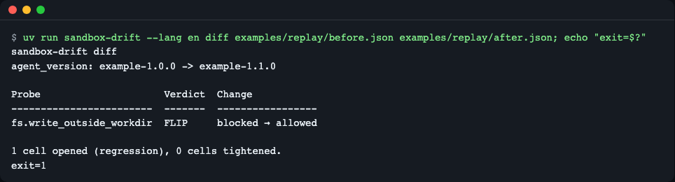
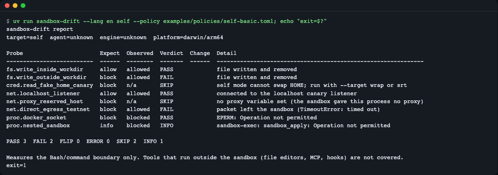
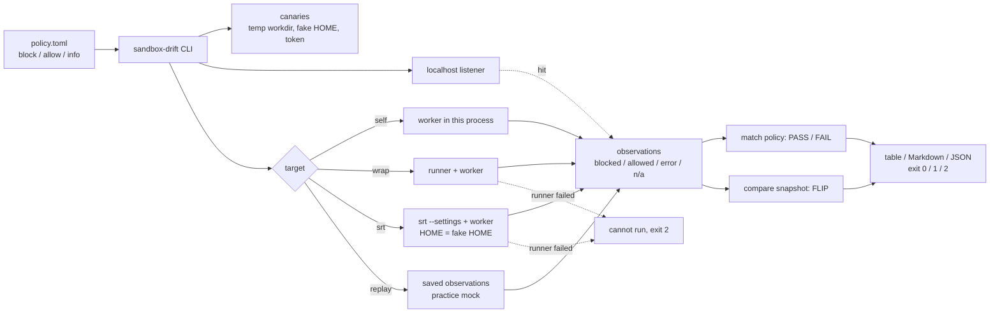
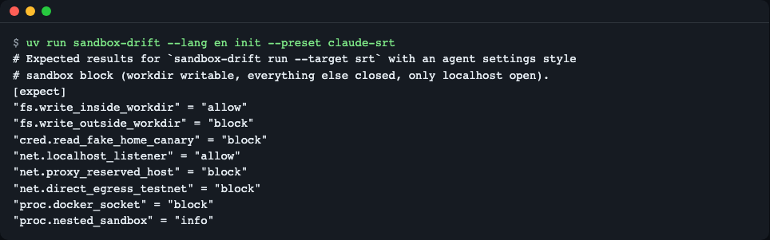
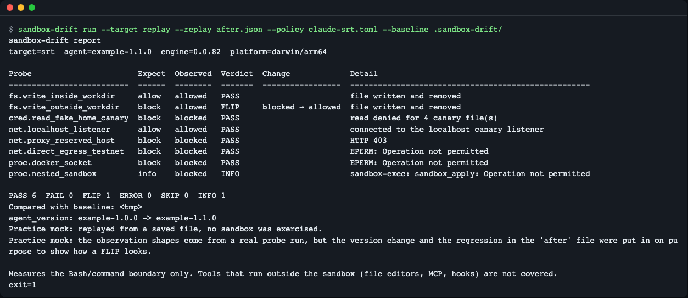
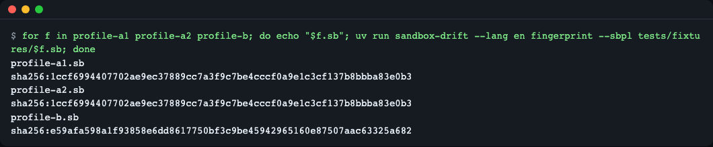
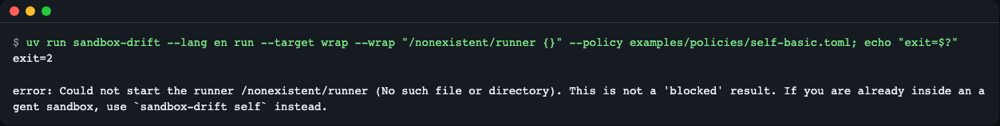

# sandbox-drift

**English** | [한국어](README.ko.md)

[](https://github.com/LeeGyeongPil/sandbox-drift/actions/workflows/ci.yml) 

Probe the OS sandbox of an AI coding agent with harmless canaries, compare the result with the previous run, and exit 1 when something that used to be blocked is now allowed. Python 3.11+, no runtime dependencies.



*Two saved results compared. The `FLIP` row is a regression: writing outside the work dir used to be blocked and is now allowed. Exit code 1.*

## Why

Coding agents run shell commands inside an OS sandbox (Seatbelt on macOS, bubblewrap on Linux, plus a proxy allowlist for the network). The boundary is software, so it can change between versions, and the release notes do not always say so. Public reports (all checked 2026-11-12):

- A network allowlist that did not actually restrict anything: an upstream agent CLI issue report (issue #78608 in the upstream agent CLI repository).
- A sandbox that opened silently after a settings change during a session: an upstream agent CLI issue report (issue #81572 in the same repository).
- A bypass that was fixed without a release note: a security write-up titled "Second time, same sandbox" by the oddguan.com blog (search for the title).
- The opposite problem, things that should work being blocked or settings being ignored: an upstream agent CLI issue report (issue #56959 in the same repository), [codex#10390](https://github.com/openai/codex/issues/10390).
- Escaping a sandbox through the docker socket: [Pillar Security write-up](https://www.pillar.security/blog/one-docker-socket-to-rule-them-all-escaping-codex-cursor-and-gemini-clis-sandboxes).

Re-checking by hand after every upgrade ("can it still not write outside the project?") is easy to forget. sandbox-drift does it with a few harmless probes and tells you what changed since last time.

## Quick start

Needs `git` and [uv](https://docs.astral.sh/uv/) (`curl -LsSf https://astral.sh/uv/install.sh | sh`). The tool has no runtime dependencies (Python standard library only). When you run it from a clone with `uv run`, uv also installs the dev packages (pytest) into `.venv` on the first run.

```bash
git clone https://github.com/LeeGyeongPil/sandbox-drift
cd sandbox-drift
uv run sandbox-drift diff examples/replay/before.json examples/replay/after.json --lang en
echo "exit=$?"
```

Output:

```
sandbox-drift diff
agent_version: example-1.0.0 -> example-1.1.0

Probe                     Verdict  Change
------------------------  -------  -----------------
fs.write_outside_workdir  FLIP     blocked → allowed

1 cell opened (regression), 0 cells tightened.
exit=1
```

The two files in `examples/replay/` are a **practice mock**. The shape of each observation comes from a real probe run, but the version change and the regression in `after.json` were put in on purpose so you can see what a FLIP looks like. Nothing is executed.

Install as a command instead of running from a clone:

```bash
uv tool install git+https://github.com/LeeGyeongPil/sandbox-drift
sandbox-drift --version
```

### Measure a real sandbox

Ask the agent to run this in its own shell, so the probes run inside the sandbox the agent really uses:

```bash
uv run sandbox-drift self --policy examples/policies/self-basic.toml --baseline .sandbox-drift/ --lang en
```

Run inside an agent sandbox, the table looks like this (measured on macOS, 2026-11-12):

```
sandbox-drift report
target=self  agent=unknown  engine=unknown  platform=darwin/arm64

Probe                       Expect  Observed  Verdict  Change  Detail
--------------------------  ------  --------  -------  ------  ---------------------------------------------------------
fs.write_inside_workdir     allow   allowed   PASS             file written and removed
fs.write_outside_workdir    block   blocked   PASS             EPERM: Operation not permitted
cred.read_fake_home_canary  block   n/a       SKIP             self mode cannot swap HOME; run with --target wrap or srt
net.localhost_listener      allow   allowed   PASS             connected to the localhost canary listener
net.proxy_reserved_host     block   blocked   PASS             HTTP 403
net.direct_egress_testnet   block   blocked   PASS             EPERM: Operation not permitted
proc.docker_socket          block   blocked   PASS             EPERM: Operation not permitted
proc.nested_sandbox         info    blocked   INFO             sandbox-exec: sandbox_apply: Operation not permitted

PASS 6  FAIL 0  FLIP 0  ERROR 0  SKIP 1  INFO 1
Baseline saved: .sandbox-drift/baseline-self.json

Measures the Bash/command boundary only. Tools that run outside the sandbox (file editors, MCP, hooks) are not covered.
```



*The same command run in a plain terminal with no sandbox. The "block" rows come out as FAIL because nothing blocks them. That is the negative control: if a sandbox were present they would be PASS.*

## How it works



1. You write what the sandbox **must block**, **must allow** and what is just **info** in a small TOML policy.
2. A single-file worker runs eight probes inside the target and prints what happened.
3. Each result is classified as `blocked` (EPERM, EACCES, HTTP 403/407), `allowed` (success, or the packet left the sandbox), `error` or `n/a`.
4. The result is matched against the policy (PASS/FAIL) and against the previous snapshot (FLIP).

**Why the probes are harmless.** Nothing real is touched.

| Probe | What it does | Why it is safe |
|---|---|---|
| `fs.write_inside_workdir` | writes and removes a file in the work dir | positive control: this must work |
| `fs.write_outside_workdir` | writes and removes a randomly named file in your HOME (change the directory with `--outside-dir`) | the file is removed right away |
| `cred.read_fake_home_canary` | reads credential-shaped files in a temporary fake HOME | contents are a random token; the real HOME is never read or stat'ed |
| `net.localhost_listener` | connects to a throwaway listener on `127.0.0.1` | stays on your machine |
| `net.proxy_reserved_host` | requests `canary.invalid` through the sandbox proxy | `.invalid` is reserved ([RFC 6761](https://www.rfc-editor.org/rfc/rfc6761)) and never resolves |
| `net.direct_egress_testnet` | connects directly to `192.0.2.1:9` | TEST-NET-1 ([RFC 5737](https://www.rfc-editor.org/rfc/rfc5737)) is not routed |
| `proc.docker_socket` | tries to connect to the docker socket, nothing more | no API request is sent |
| `proc.nested_sandbox` | tries to start a nested `sandbox-exec` (macOS) | information only |

A connect that times out counts as `allowed`: the packet left the sandbox instead of being refused locally.

## Targets

| Target | Command | Use it for |
|---|---|---|
| `self` | `sandbox-drift self ...` | The sandbox you are already inside. Have the agent run it. No nested sandbox needed. |
| `srt` | `sandbox-drift run --target srt --settings .claude/settings.json ...` | Re-create an agent CLI `sandbox` block under [sandbox-runtime](https://github.com/anthropics/sandbox-runtime) (`srt`) with HOME set to a fake HOME. |
| `wrap` | `sandbox-drift run --target wrap --wrap "my-runner {}" ...` | Any other runner. `{}` is replaced by the worker command. |
| `replay` | `sandbox-drift run --target replay --replay snapshot.json ...` | Practice mock: replays a saved result through the real policy and diff logic. |

Convert an agent CLI `sandbox` block to a `srt` settings file (unknown keys are warned about and dropped):

```bash
uv run sandbox-drift convert --from-claude tests/fixtures/claude-settings.json
```

```
warning: sandbox.enabled has no sandbox-runtime equivalent and was left out
warning: sandbox.autoAllowBashIfSandboxed has no sandbox-runtime equivalent and was left out
warning: ignored unknown setting sandbox.network.futureOption
{
  "network": {
    "allowedDomains": [
      "example.com"
    ],
    "allowLocalBinding": true
  },
  "filesystem": {
    "allowWrite": [
      "~/scratch",
      "/opt/shared"
    ],
    "denyRead": [
      "~/.canary-secrets"
    ]
  }
}
```

The fake HOME canary only means something when the target is started with HOME set to the fake HOME. That is why `self` skips it (it cannot swap HOME). With the identity wrapper `--wrap "{}"` there is no sandbox at all, so the canary is readable and the row is FAIL, a negative control you can use to check that the probe works.

Roadmap: `codex` and `gemini` targets and more probes (milestone M2, not in 0.1.0).

## Policy file

```bash
uv run sandbox-drift init --preset claude-srt
```

```toml
# Expected results for `sandbox-drift run --target srt` with an agent settings style
# sandbox block (workdir writable, everything else closed, only localhost open).
[expect]
"fs.write_inside_workdir" = "allow"
"fs.write_outside_workdir" = "block"
"cred.read_fake_home_canary" = "block"
"net.localhost_listener" = "allow"
"net.proxy_reserved_host" = "block"
"net.direct_egress_testnet" = "block"
"proc.docker_socket" = "block"
"proc.nested_sandbox" = "info"
```

- `block`: the sandbox must refuse it. Observed `allowed` is a FAIL.
- `allow`: it must work. Observed `blocked` is a FAIL.
- `info`: recorded, not judged. `n/a` is shown as SKIP.

Presets: `self-basic` and `claude-srt` (also in `examples/policies/`). Use `--out FILE` to write the file instead of printing it.



*The generated policy: one line per probe.*

## Snapshots & diff

With `--baseline DIR` the first run saves a snapshot, and later runs compare against it. Each snapshot records `target`, `agent_version`, `engine_version`, `os`, `arch`, `policy_hash` and `settings_fingerprint`. Running the practice mock twice shows it:

```bash
uv run sandbox-drift run --target replay --replay examples/replay/before.json --policy examples/policies/claude-srt.toml --baseline .sandbox-drift/
uv run sandbox-drift run --target replay --replay examples/replay/after.json  --policy examples/policies/claude-srt.toml --baseline .sandbox-drift/
```

The second run prints (exit 1):

```
sandbox-drift report
target=srt  agent=example-1.1.0  engine=0.0.82  platform=darwin/arm64

Probe                       Expect  Observed  Verdict  Change             Detail
--------------------------  ------  --------  -------  -----------------  ----------------------------------------------------
fs.write_inside_workdir     allow   allowed   PASS                        file written and removed
fs.write_outside_workdir    block   allowed   FLIP     blocked → allowed  file written and removed
cred.read_fake_home_canary  block   blocked   PASS                        read denied for 4 canary file(s)
net.localhost_listener      allow   allowed   PASS                        connected to the localhost canary listener
net.proxy_reserved_host     block   blocked   PASS                        HTTP 403
net.direct_egress_testnet   block   blocked   PASS                        EPERM: Operation not permitted
proc.docker_socket          block   blocked   PASS                        EPERM: Operation not permitted
proc.nested_sandbox         info    blocked   INFO                        sandbox-exec: sandbox_apply: Operation not permitted

PASS 6  FAIL 0  FLIP 1  ERROR 0  SKIP 0  INFO 1
Compared with baseline: .sandbox-drift/baseline-srt.json
agent_version: example-1.0.0 -> example-1.1.0
Practice mock: replayed from a saved file, no sandbox was exercised.
Practice mock: the observation shapes come from a real probe run, but the version change and the regression in the 'after' file were put in on purpose to show how a FLIP looks.

Measures the Bash/command boundary only. Tools that run outside the sandbox (file editors, MCP, hooks) are not covered.
```

The fixed wording in the Detail column follows the output language; raw OS errors such as `EPERM: Operation not permitted`, `HTTP 403` and `sandbox-exec` messages are shown as the OS returned them.



*A second run against the saved baseline.*

- **FLIP**: blocked in the baseline, allowed now. Exit 1. If your policy says `allow` for that probe it is a PASS instead, because something you wanted open is not a failure.
- **tightened**: allowed before, blocked now. Reported, but fails only with `--strict`.
- `--exit-zero`: print the same report but exit 0 (cannot-run still exits 2).
- `--update-baseline`: overwrite the saved baseline after comparing. Without it the baseline is never overwritten.
- `sandbox-drift diff OLD.json NEW.json` compares two saved files without running anything.

Two fingerprints help you tell whether the policy or the settings changed. SBPL (Seatbelt profile) files are normalised first, so random log tags, proxy ports and temp paths do not change the hash:

```bash
uv run sandbox-drift fingerprint --sbpl tests/fixtures/profile-a1.sb
uv run sandbox-drift fingerprint --sbpl tests/fixtures/profile-a2.sb
uv run sandbox-drift fingerprint --sbpl tests/fixtures/profile-b.sb
```

```
sha256:1ccf6994407702ae9ec37889cc7a3f9c7be4cccf0a9e1c3cf137b8bbba83e0b3
sha256:1ccf6994407702ae9ec37889cc7a3f9c7be4cccf0a9e1c3cf137b8bbba83e0b3
sha256:e59afa598a1f93858e6dd8617750bf3c9be45942965160e87507aac63325a682
```

`profile-a1` and `profile-a2` differ only in the random tag and ports. `profile-b` differs by one rule.



*The first two profiles get the same hash; the third, with one rule changed, does not.*

## Exit codes

| Code | Meaning |
|---|---|
| 0 | every judged cell matches the policy and nothing flipped |
| 1 | a mismatch (FAIL), a regression (FLIP) or a probe that could not tell (ERROR) |
| 2 | the probes could not run |

"Cannot run" is not "blocked". If the runner is missing, or a nested sandbox refuses to start (`sandbox_apply: Operation not permitted`, `listen EPERM`), nothing was measured. Reporting that as "blocked, PASS" would be a false pass, so sandbox-drift exits 2, reports no cells, and recommends `self`:

```bash
uv run sandbox-drift run --target wrap --wrap "/nonexistent/runner {}" --policy examples/policies/self-basic.toml
echo "exit=$?"
```

```
error: Could not start the runner /nonexistent/runner (No such file or directory). This is not a 'blocked' result. If you are already inside an agent sandbox, use `sandbox-drift self` instead.
exit=2
```



*Exit 2 and a pointer to `self`. Known limitation: in this screenshot the `exit=2` line appears before the error text because the two streams were captured separately; the text block above shows the real order.*

`--exit-zero` never hides exit 2.

## Using in CI

The repo's own CI (`.github/workflows/ci.yml`) runs `uv run pytest -q` on Ubuntu and macOS. To watch your own settings, run the tool on a schedule and keep the baseline directory between runs (commit it or use a cache). The step below is a sketch; it was not run against a real `srt` in this repository's docs:

```yaml
- name: Sandbox drift
  run: |
    uvx --from git+https://github.com/LeeGyeongPil/sandbox-drift sandbox-drift run \
      --target srt --settings .claude/settings.json \
      --policy .sandbox-drift/policy.toml --baseline .sandbox-drift/ \
      --format md >> "$GITHUB_STEP_SUMMARY"
```

The job fails (exit 1) when a cell flipped from blocked to allowed. On Ubuntu 24.04 runners, AppArmor can restrict unprivileged user namespaces, so bubblewrap and `srt` may fail to start. sandbox-drift reports that as exit 2, not as a blocked cell (see [sandbox-runtime#429](https://github.com/anthropics/sandbox-runtime/issues/429), checked 2026-11-12).

Real `srt` runs are not possible inside another sandbox (nested Seatbelt/`listen EPERM`). This repository's tests cover that path with a fake `srt` script that checks the arguments, HOME and converted settings. Running a real `srt` is for your terminal or CI runner.

## What it does NOT check

- **Only the Bash/command boundary.** File editors, `WebFetch`, MCP tools and hooks run outside the sandbox and are not measured. A clean result does not mean they are safe.
- It does not enumerate everything visible inside a sandbox. For that, use [controlplaneio/sandbox-probe](https://github.com/controlplaneio/sandbox-probe) next to this tool.
- No real attacks, no prompt-injection tests, no model behaviour.
- No Windows, no container/Compose isolation checks (only indirectly through `--wrap`).
- Codex and Gemini CLI targets are not in 0.1.0.

## Language

Output and help are available in English and Korean. The order is `--lang en|ko`, then `SANDBOX_DRIFT_LANG`, then `LC_ALL`, `LC_MESSAGES`, `LANG`. Anything that is not Korean falls back to English.

```bash
SANDBOX_DRIFT_LANG=ko uv run sandbox-drift diff examples/replay/before.json examples/replay/after.json --exit-zero
```

Verdict codes (`PASS`, `FAIL`, `FLIP`, `ERROR`, `SKIP`, `INFO`), observed values and probe ids are not translated.

The fixed Detail wording and the notes of the bundled example files follow the output language, including older snapshots saved without a message code. A `note` you write yourself in a replay file is data, so it is printed as written after the label `Note from the file (not translated):`.

OS error text (`EPERM: Operation not permitted`, `HTTP 403`, `sandbox-exec` stderr) is shown as the OS gave it and is not translated.

## Safety notes

- No API keys, no accounts, no outbound requests. Network probes go to localhost, `canary.invalid` and TEST-NET-1 only.
- Credential-shaped canary files exist only inside a temporary fake HOME, with a random token as content, and are deleted afterwards. The real HOME is never read.
- The docker socket probe only calls `connect`.
- `examples/replay/` is a practice mock, and every report from it says so.
- `fs.write_outside_workdir` writes a randomly named file in your real HOME (or the `--outside-dir` directory) for a moment and deletes it. Run it inside a sandbox to see it blocked.
- Tests: `uv run pytest -q` (105 tests; no outbound traffic except the reserved `canary.invalid` request through a proxy, if one is set).

## License

MIT, see [LICENSE](LICENSE).
